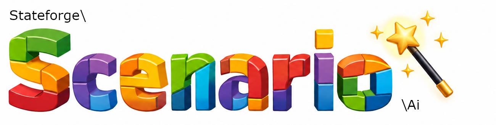

# Stateforge Scenario AI

**Generate Scenarios and Parameter Types using artificial intelligence.**

Stateforge Scenario AI extends the Stateforge Scenario framework with AI-assisted code generation.

Instead of writing every Scenario or Parameter Type manually, describe what you want to achieve in natural language. Scenario AI uses the framework documentation, predefined code blueprints, and optional project-specific information to generate PHP code that follows the conventions of the Scenario framework.

The generated code is validated and saved for review before activation.

## Features

- **Natural language code generation** – Generate Scenarios and Parameter Types by describing their intended behavior.
- **Framework-aware generation** – Uses Scenario documentation, configuration, and code blueprints to guide the AI.
- **Interactive conversations** – The AI can ask follow-up questions when additional information is required.
- **Project context** – Optionally provide project-specific documentation to improve generated results.
- **Controlled source code access** – The AI can request access to existing PHP classes. Source code is only shared after explicit user confirmation.
- **Code validation** – Generated PHP code is validated before being saved.
- **Review before activation** – Generated files remain inactive until reviewed and renamed.
- **Extensible AI integration** – Supports custom AI adapters.

## Requirements

Stateforge Scenario AI requires an existing Stateforge Scenario installation.

The Scenario AI extension uses the framework's configuration, Scenario suites, Parameter Type directory, and extension system.

## Installation

### 1. Install Stateforge Scenario AI

Install the Scenario AI package in a project that already uses Stateforge Scenario.

### 2. Register the Extension

Open your `scenario.xml` configuration file and register the Scenario AI extension:

```xml
<extensions>
    <bootstrap class="Stateforge\Scenario\Ai\Extension" />
</extensions>
```

A complete configuration might look like this:

```xml
<scenario xmlns:xsi="http://www.w3.org/2001/XMLSchema-instance"
    xsi:noNamespaceSchemaLocation="vendor/stateforge/scenario-core/xsd/scenario.xsd"
    cacheDirectory=".scenario.cache"
    parameterDirectory="scenario/parameter"
>
    <database>
        <connection>migration.php</connection>
    </database>

    <suites>
        <suite name="main" description="Main Scenario Suite">
            <directory>scenario/main</directory>
        </suite>
    </suites>

    <extensions>
        <bootstrap class="Stateforge\Scenario\Ai\Extension" />
    </extensions>
</scenario>
```

The extension integrates Scenario AI into the existing Scenario application.

### 3. Initialize Scenario AI

Run the installation command:

```bash
php vendor/bin/scenario ai-install
```

This command initializes the Scenario AI installation.

### 4. Configure the AI Provider

Scenario AI uses a separate XML configuration file named `scenario-ai.xml`.

For example:

```xml
<scenario-ai xmlns:xsi="http://www.w3.org/2001/XMLSchema-instance"
    xsi:noNamespaceSchemaLocation="xsd/scenario-ai.xsd"
    maxQuestions="3"
    projectDoc="mydocs"
>
    <adapter type="openai">
        <var name="apiKey">YOUR_OPENAI_API_KEY</var>
    </adapter>
</scenario-ai>
```

Replace `YOUR_OPENAI_API_KEY` with your own API key.

**Important:** Never commit real API keys or other credentials to a public repository. Keep configuration files containing credentials outside version control.

## Configuration

Scenario AI uses two configuration files:

- `scenario.xml` – Defines the Scenario framework configuration, including suites, directories, and extensions.
- `scenario-ai.xml` – Defines the AI adapter and AI-specific settings.

### `maxQuestions`

Controls the configured limit for AI follow-up questions.

```xml
maxQuestions="3"
```

If the value is missing, invalid, or negative, the default value is `3`.

### `projectDoc`

Specifies the path to optional project-specific documentation.

```xml
projectDoc="mydocs"
```

The path is resolved relative to the project root directory.

Project documentation helps the AI understand application-specific conventions, architecture, and requirements.

Only configure documentation that is appropriate to share with the selected AI provider.

### `adapter`

Defines the AI provider used for code generation.

```xml
<adapter type="openai">
    <var name="apiKey">YOUR_OPENAI_API_KEY</var>
</adapter>
```

The `type` attribute selects the adapter.

Nested `var` elements provide adapter-specific configuration values.

Each variable uses a `name` attribute and a text value.

## Usage

Start the interactive AI code generator:

```bash
php vendor/bin/scenario ai-make
```

Scenario AI displays an introduction and asks you to describe the Scenario or Parameter Type you want to generate.

For example:

```text
Please describe the scenario or parameter type.
```

Enter your requirements in natural language.

Scenario AI analyzes the request and attempts to generate a corresponding PHP implementation.

If additional information is required, the AI may ask follow-up questions or request access to existing application classes.

## Generating a Scenario

A Scenario describes how to prepare a specific application state.

For example, consider an application that needs three users in a fresh database for testing.

Start Scenario AI:

```bash
php vendor/bin/scenario ai-make
```

Enter a request such as:

> Create a Scenario that creates three new users of the class App\Entity\User in a fresh database.

Scenario AI uses the request, framework documentation, and configured Scenario suites to generate a corresponding PHP class.

Depending on the available project information, the generated code may include attributes such as:

```php
#[AsScenario(
    name: 'create-three-users-in-fresh-database',
    description: 'Creates three users in a fresh database.'
)]
#[RefreshDatabase]
```

The generated implementation depends on the information available about the application's entities and persistence layer.

If the AI does not know how your application creates or persists users, it may generate TODO comments instead of inventing application-specific APIs.

For example:

```php
public function up(): void
{
    // TODO: Instantiate three App\Entity\User objects.
    // TODO: Set the required fields according to the entity API.
    // TODO: Persist the users using the project's persistence layer.
}
```

This allows Scenario AI to generate a useful starting point without making unverifiable assumptions about your application.

## Generating a Parameter Type

Parameter Types define how Scenario parameters are represented and processed.

Scenario AI can generate Parameter Types from natural language descriptions.

Start the generator:

```bash
php vendor/bin/scenario ai-make
```

Enter a request such as:

> Create a Parameter Type that accepts a date of birth and converts it into a DateTimeImmutable instance.

Scenario AI uses the Parameter Type blueprint and framework documentation to generate the corresponding PHP class.

Generated implementations can include methods such as:

- `cast()` – Converts the supplied value into the required representation.
- `valueType()` – Defines the supported input value type.

As with Scenarios, generated Parameter Types must be reviewed before activation.

## Interactive Conversations

Scenario AI supports interactive conversations during code generation.

The AI can request additional information when the initial description is insufficient.

### Follow-up Questions

For example, the AI might need to know:

- Which application class represents a particular entity.
- Which fields are required to create an object.
- Which persistence mechanism the application uses.
- Which behavior the generated Scenario should implement.

The CLI displays the AI's question and waits for your answer.

The conversation continues until a result is generated or the configured generation process cannot continue.

### Access to Existing Classes

Some Scenarios depend on existing application classes.

Scenario AI can identify relevant class names and request access to their source code.

Before source code is shared, the CLI asks for explicit confirmation:

```text
Can the source code for class "App\Entity\User" be sent to AI?
```

You can approve or decline each request.

Only approved source code is included through this interactive mechanism.

This allows the AI to better understand application-specific classes while keeping the developer in control of source code sharing.

**Source code is not shared through this mechanism without explicit confirmation.**

## Project Documentation

Scenario AI can use optional project-specific documentation to improve generated results.

Configure the documentation directory using the `projectDoc` attribute:

```xml
<scenario-ai
    maxQuestions="3"
    projectDoc="mydocs"
>
    <!-- Adapter configuration -->
</scenario-ai>
```

Project documentation can describe:

- Application architecture
- Entity relationships
- Coding conventions
- Persistence mechanisms
- Domain-specific requirements
- Common application workflows

This information helps the AI generate code that better matches the application's existing structure.

Project documentation is optional.

If no project documentation is configured, Scenario AI continues to use the Scenario framework documentation and code blueprints.

## Code Generation Process

Scenario AI combines natural language processing with the structure and conventions of the Scenario framework.

The generation process consists of several steps.

### 1. Build Instructions

Scenario AI prepares instructions for the selected AI provider.

These instructions include the relevant Scenario framework documentation, code blueprints, and configuration information.

Optional project documentation can provide additional context.

### 2. Process the Request

The AI analyzes the natural language request and determines which type of code should be generated.

The supported generation types include:

- Scenario
- Parameter Type

### 3. Request Additional Information

If the request is incomplete or ambiguous, the AI may ask follow-up questions.

It may also request access to existing application classes.

Source code is only shared after explicit confirmation.

### 4. Generate PHP Code

The AI generates PHP code based on the available instructions and project context.

The generated implementation may include:

- Namespace declarations
- Class definitions
- Required imports
- Framework attributes
- Method implementations
- TODO comments for missing application-specific details

### 5. Validate the Result

Scenario AI validates the generated result before accepting it.

If validation fails, the generation process can request a corrected response.

Validation helps ensure that generated code follows the expected structure and conventions of the Scenario framework.

### 6. Determine the Destination

The generated PHP code is analyzed using an Abstract Syntax Tree (AST).

Scenario AI uses the generated namespace and class name together with the Scenario configuration to determine the destination directory.

### 7. Save the Generated Code

Once the result has been accepted, the generated PHP code is saved to a file.

The file receives an `.ai` suffix to prevent immediate activation.

### 8. Review and Activate

Review the generated implementation carefully.

When you are satisfied with the result, remove the `.ai` suffix to activate the file.

## Generated Files

Scenario AI uses the configured Scenario suites and Parameter Type directory to determine where generated files belong.

For example, the following Scenario configuration:

```xml
<suites>
    <suite name="main" description="Main Scenario Suite">
        <directory>scenario/main</directory>
    </suite>
</suites>
```

defines the directory for the `main` Scenario suite.

A generated Scenario might be saved as:

```text
scenario/main/CreateThreeUsersInFreshDatabase.php.ai
```

After reviewing the implementation, rename the file:

```text
scenario/main/CreateThreeUsersInFreshDatabase.php
```

The same principle applies to generated Parameter Types.

For example:

```text
scenario/parameter/BirthDateType.php.ai
```

After review:

```text
scenario/parameter/BirthDateType.php
```

**Generated files must be reviewed before activation.**

## Validation

Scenario AI includes a validation system for generated code.

The validation process is designed to check generated implementations against the requirements of the Scenario framework.

Validation is independent of the AI provider.

This allows the same validation process to be used with different AI adapters.

If validation fails, Scenario AI can request a corrected response.

However, validation does not guarantee that generated code is logically correct, secure, or suitable for production.

Developers remain responsible for reviewing and testing generated implementations.

## AI Providers

Scenario AI separates the code generation workflow from the AI provider.

This architecture allows different AI providers to be integrated through adapters.

### OpenAI

The initial implementation includes an OpenAI adapter.

The adapter communicates with the OpenAI API and processes structured responses.

Example configuration:

```xml
<adapter type="openai">
    <var name="apiKey">YOUR_OPENAI_API_KEY</var>
</adapter>
```

### Custom Adapters

Scenario AI supports custom adapters.

Custom adapters allow alternative AI providers or implementations to be integrated without changing the core generation workflow.

The adapter system separates provider-specific communication from:

- Instruction generation
- Conversation management
- Response processing
- Code validation
- File generation

Custom adapter implementations must follow the contracts defined by Scenario AI.

### Planned Providers

Support for Claude is planned.

The adapter architecture is intended to make additional providers possible without redesigning the complete generation workflow.

## Architecture

Scenario AI separates the responsibilities involved in AI-assisted code generation.

### Context

The context provides the instructions and validators used during generation.

It combines the Scenario framework documentation, code blueprints, and optional project-specific information.

### Instructions

Instructions describe the framework conventions and requirements that generated code should follow.

They provide the AI with the information needed to produce compatible Scenarios and Parameter Types.

### AI Adapters

Adapters handle communication with individual AI providers.

Each adapter is responsible for creating a client that communicates with its provider.

### Conversation Management

Conversation management coordinates requests, responses, follow-up questions, and generation attempts.

### Response Processing

Structured AI responses are converted into internal response objects.
These responses contain the generated code and additional information required by the generation workflow.

### Validation

Validators inspect generated results before they are accepted.
The validation process is independent of the selected AI provider.

### AST Processing

Scenario AI uses PHP's Abstract Syntax Tree representation to analyze generated code.
The AST is used to determine structural information such as the generated class name and namespace.

### File Generation

The code generation component determines the destination directory based on the Scenario configuration and the generated class namespace.
Generated code is written to a file with an `.ai` suffix.

## Security and Privacy

Scenario AI is designed to keep the developer in control of the generation process.

### Source Code Sharing

When the AI requests access to an existing project class, the interactive command asks for confirmation before sending its source code.
Declining the request prevents that class from being shared through this mechanism.

### Project Documentation

Project-specific documentation is optional.
Only configure documentation that is appropriate to share with the selected AI provider.

### API Credentials

API credentials should be treated as sensitive information.
Do not commit real API keys to public repositories.
Keep configuration files containing credentials outside version control.

### Generated Code

Generated PHP code is not automatically activated.
Files are saved with an `.ai` suffix and must be reviewed before activation.

### External AI Providers

The generation request, configured instructions, and any approved project context are transmitted to the selected AI provider.
Review the provider's privacy and data handling policies before using Scenario AI with sensitive project information.

### Developer Responsibility

AI-generated code may contain mistakes, incomplete implementations, or incorrect assumptions.
Validation improves reliability but does not guarantee correctness.
Always review generated code and test its behavior before using it in an application.

## Extensibility

Scenario AI is designed to be extensible.
Its architecture separates framework-specific generation logic from provider-specific communication.
This makes it possible to integrate additional AI providers while retaining the same core generation workflow.
Custom adapters can implement alternative communication mechanisms without changing the existing Scenario generation and validation components.

## Philosophy

Stateforge Scenario AI is intended to assist developers, not replace their judgment.
The developer describes the desired application state or Parameter Type.
The AI helps translate that description into framework-compatible PHP code.
The Scenario framework provides the structure, conventions, and validation mechanisms.
The developer remains responsible for reviewing and approving the generated implementation.

**Describe the state. Generate the code. Review the result.**